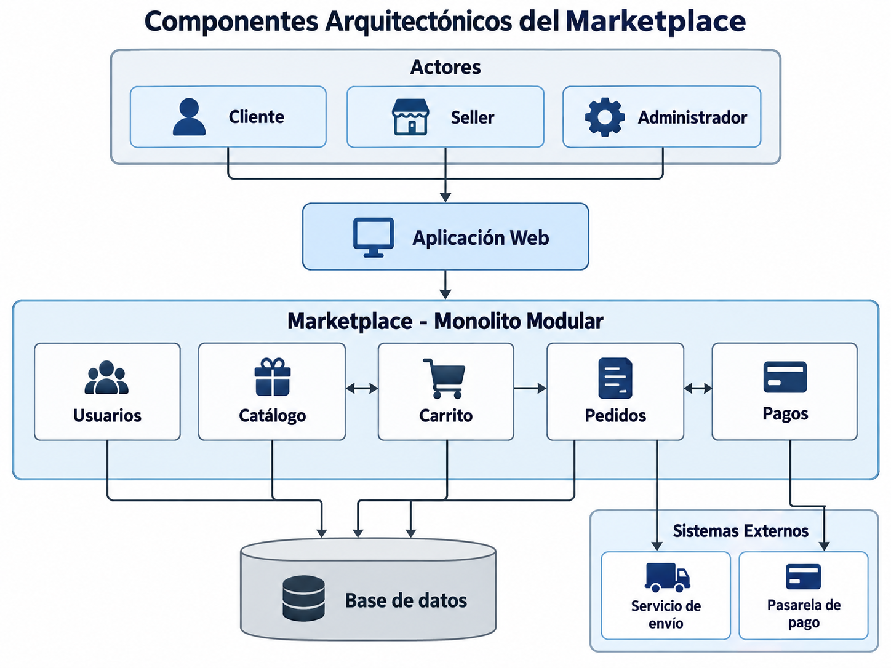

# Componentes arquitectónicos del Marketplace

## Descripción

El Marketplace se organiza en componentes que representan las principales
responsabilidades del sistema.

Los componentes principales son:

- **Usuarios:** gestiona la información y operaciones relacionadas con clientes, sellers y administradores.
- **Catálogo:** permite consultar y administrar los productos disponibles.
- **Carrito:** gestiona los productos seleccionados por el cliente antes de realizar una compra.
- **Pedidos:** registra y administra las órdenes de compra.
- **Pagos:** coordina el procesamiento de pagos mediante una pasarela externa.

Estos componentes forman parte del Monolito Modular definido para el sistema y
se relacionan entre sí para completar el flujo de compra.

## Relación entre componentes

El flujo principal del Marketplace es:

Cliente → Catálogo → Carrito → Pedidos → Pagos

El componente de Pagos se comunica con una pasarela de pago externa y el
componente de Pedidos puede comunicarse con el servicio de envío.

## Diagrama de componentes arquitectónicos

El siguiente diagrama representa los principales componentes del Marketplace,
sus relaciones internas, el acceso a datos y la comunicación con sistemas externos.

